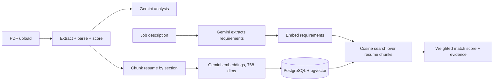

# AI Resume Analyzer

Upload a PDF resume and get a structured parse, a resume score, and an AI quality review. Then paste a job description and see how well the resume matches it, with evidence for every matched requirement and a list of what's missing.

Built with a PERN stack, Gemini, and a RAG pipeline on PostgreSQL + pgvector.

## Features

- **PDF parsing:** extracts text, page count and embedded links (LinkedIn, GitHub, portfolio), then structures it into profile, summary, education, experience, projects and categorized skills.
- **Resume scoring:** deterministic score with a breakdown, strengths, weaknesses and interpretation.
- **AI analysis (Gemini):** contextual review of content relevance, clarity, evidence of impact, experience and skills strength, plus section-level suggestions.
- **ATS-style job matching (RAG):** paste a job description and get a 0-100 match score, matched requirements with resume evidence, and missing requirements, each tagged must-have or nice-to-have.
- **Resilient by design:** parsing and scoring work even when Gemini is unavailable; indexing runs independently of the AI analysis.

## How it works



**Indexing (at upload).** The parsed resume is split into chunks (one per experience or project entry, plus one per remaining section; chunks over ~800 characters are split at sentence boundaries). Each chunk is embedded with `gemini-embedding-001` at 768 dimensions and stored in `resume_chunks` with an HNSW cosine index.

**Matching (when a job description is submitted).**
1. Gemini extracts up to 25 atomic requirements, each categorized (`skill`, `experience`, `education`, `other`) and weighted (`must` or `nice`).
2. Each requirement is embedded and matched against the resume's chunks by cosine distance (`similarity = 1 - distance`).
3. A requirement counts as matched when similarity is at or above `MATCH_THRESHOLD` (default `0.6`, set in `backend/rag/matcher.js`).
4. Score = weighted coverage: must-haves count double, and matched items earn partial credit equal to their similarity. The result is an integer from 0 to 100.

## Tech stack

| Layer | Tools |
|---|---|
| Frontend | React, Vite |
| Backend | Node.js, Express |
| AI | Google Gemini (`@google/genai`): analysis, requirement extraction, embeddings |
| Database | PostgreSQL 16 + pgvector 0.8 (Docker) |

## Project structure

```
AI-Resume-Analyzer/
├── backend/
│   ├── index.js                 # server entry
│   ├── src/
│   │   ├── app.js               # Express app, routes mounted at /api/resume
│   │   ├── routes/resumeRoutes.js
│   │   ├── services/geminiService.js
│   │   └── utils/               # resumeParser.js, PDF link extraction
│   ├── rag/
│   │   ├── chunker.js           # resume -> chunks
│   │   ├── embedder.js          # Gemini embeddings (768 dims)
│   │   ├── ingest.js            # transactional insert of resume + chunks
│   │   ├── retriever.js         # cosine search
│   │   ├── jdExtractor.js       # job description -> requirements
│   │   ├── matcher.js           # requirements -> score + evidence
│   │   └── test-*.js            # smoke tests
│   └── db/
│       ├── schema.sql           # resumes, resume_chunks, HNSW index
│       ├── pool.js
│       ├── migrate.js
│       └── test.js
└── frontend/
    └── src/
        ├── pages/upload.jsx
        ├── components/MatchResults.jsx
        └── services/api.js
```

## API

### `POST /api/resume/parse`

Multipart upload with a PDF file. Returns the parsed resume, score and breakdown, categorized skills, Gemini analysis (or an "unavailable" flag if the AI call fails), and `resumeId` (`null` if indexing failed).

### `POST /api/resume/:id/match`

```json
{ "jobDescription": "At least 50 characters of job description text..." }
```

Response:

```json
{
  "score": 72,
  "matched": [
    {
      "requirement": "Node.js",
      "importance": "must",
      "similarity": 0.81,
      "evidence": { "section": "experience", "content": "..." }
    }
  ],
  "missing": [
    { "requirement": "Kubernetes", "importance": "nice", "bestSimilarity": 0.41 }
  ],
  "threshold": 0.6
}
```

Errors: `400` invalid input, `404` resume not found, `500` generic failure.

## Scripts

Run from `backend/`:

| Script | Purpose |
|---|---|
| `npm run db:migrate` | Apply `schema.sql` (idempotent) |
| `npm run db:test` | Insert, vector-query and clean up a dummy row |
| `npm run rag:test` | Ingestion and similarity smoke test |
| `npm run rag:retrieve` | Retrieval smoke test |
| `npm run rag:match` | End-to-end job matching test (prints similarities for threshold tuning) |

Frontend: `npm run dev`, `npm run build`, `npm run lint`.

## Troubleshooting

- **Score shows N/A / "analysis unavailable":** Gemini returned 429/503 (overloaded model). Configure `GEMINI_FALLBACK_MODELS` or retry later. Parsing still works.
- **"Comparison is unavailable for this upload":** the resume wasn't indexed. Check that `resume-pg` is running (`docker ps`) and `DATABASE_URL` is correct.
- **`GOOGLE_APPLICATION_CREDENTIALS` error:** the API key wasn't loaded. Run scripts from `backend/` so dotenv finds `.env`.
- **Check which models your key can call:**
  ```bash
  node -e "require('dotenv').config(); const {GoogleGenAI}=require('@google/genai'); (async()=>{const ai=new GoogleGenAI({apiKey:process.env.GEMINI_API_KEY}); for await (const m of await ai.models.list()) console.log(m.name)})()"
  ```

## Known limitations

- No authentication or per-user resume history; resumes are stored without ownership.
- PDF only.
- The match threshold (`0.6`) is a starting point and should be tuned against real resume/JD pairs.
- Legacy `MONGO_URI` handling remains in `backend/index.js` and is unused.

## Roadmap

- [ ] Tune the match threshold and add an evaluation script (resume/JD pairs with expected score ranges)
- [ ] Return parsed data and score instantly, loading the AI analysis progressively
- [ ] Docker Compose for one-command local setup
- [ ] Deployment
- [ ] Authentication and resume history

## Author

**Fahad Ahmad**, [LinkedIn](https://www.linkedin.com/in/fahadahmad0013) · [GitHub](https://github.com/fahadahmad9)