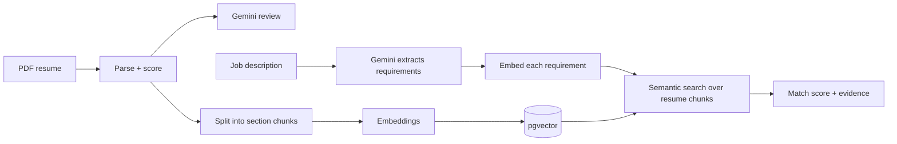

# AI Resume Analyzer

An AI-powered tool that reads a resume, scores it, and tells you how well it fits a specific job, with evidence for every claim it makes.

Upload a PDF. Get a structured breakdown, a quality score and an AI review. Then paste a job description and see exactly which requirements your resume covers, which it doesn't, and where in your resume the proof lives.

[Try the live application](https://ai-resume-analyzer-tan-zeta-8sw4de8axm.vercel.app/)

## The problem

Job seekers send resumes into a black box.

- **Applicant tracking systems filter first.** Most applications are screened by software before a human reads them, and candidates never learn why they were filtered out.
- **Generic resume feedback isn't tied to a job.** "Add more metrics" is advice, but "this role requires Docker and your resume never mentions it" is actionable.
- **Keyword matching is brittle.** A resume that says *"built REST endpoints for patient records"* fits a job asking for *"API development experience"*, but a keyword scanner misses it. Matching on meaning is the point.

This project tackles all three: it parses and evaluates the resume, then compares it to a job description by **semantic similarity** rather than exact words.

## What it does

1. **Parses** a PDF resume into structured data: profile, links, summary, education, experience, projects and categorized skills.
2. **Scores** it with a deterministic rubric (with a breakdown, strengths and weaknesses), so the same resume always gets the same score.
3. **Reviews** it with Gemini: content relevance, clarity, evidence of impact, and strength of experience and skills.
4. **Matches** it against a job description: a 0-100 fit score, the requirements that are covered (with the resume text that proves it), and the ones that are missing.

## How it works

The first half of the pipeline runs on every upload. The second half runs only when the user submits a job description.

## Where RAG comes in

RAG (retrieval-augmented generation) powers the job-matching feature. The idea is to find the relevant evidence first, then judge it, instead of handing the whole resume and job description to a model and asking "how well do these match?"

**At upload (indexing).** The parsed resume is split into meaningful chunks: one per experience or project entry, plus one per remaining section. Each chunk is converted into a 768-dimension embedding and stored in PostgreSQL with pgvector. Splitting by section keeps each chunk about one coherent thing, so a search result is a self-contained piece of evidence.

**At comparison (retrieval).**
1. Gemini reads the job description and breaks it into short, atomic requirements, such as "Docker" or "3+ years Node.js", each tagged as a must-have or a nice-to-have.
2. Each requirement is embedded and used to search the resume's chunks for the closest match by cosine similarity.
3. If the best chunk is similar enough, the requirement counts as covered, and that chunk is shown as evidence. If not, it's reported as missing.
4. The score is weighted coverage: must-haves count double, and matched requirements earn partial credit based on how strong the match is.

**Why this beats the simple approach:**
- **Explainable.** Every matched requirement points to the exact resume text behind it. A bare number from an LLM can't do that.
- **Repeatable.** Similarity scores are computed, not generated, so the same inputs give the same result.
- **Per-requirement precision.** Each requirement is checked on its own, so a strong section can't hide a gap elsewhere.
- **Fast and cheap at comparison time.** Resumes are embedded once at upload. Comparing against a new job description costs one requirement-extraction call plus one batch of embeddings, not a full-document analysis.
- **Built to scale.** The same index could compare one resume to many jobs, or many resumes to one job.

## Design decisions

- **Deterministic scoring alongside AI review.** The rubric score is stable and explainable. Gemini adds nuance on quality and context. Neither replaces the other.
- **Matching on meaning, not keywords.** Embeddings catch paraphrases and related skills that string matching would miss.
- **Must-have vs nice-to-have weighting.** A missing core requirement should hurt more than a missing bonus skill, as it would in a real screening.
- **Tunable threshold.** The similarity cutoff for "matched" is a single constant, calibrated against real resume and job description pairs rather than guessed once and forgotten.
- **Evidence over verdicts.** The UI shows why a requirement was matched, so users can judge the result themselves.

## Tech stack

- **Frontend:** React (Vite)
- **Backend:** Node.js, Express
- **AI:** Google Gemini for resume review and requirement extraction; `gemini-embedding-001` for embeddings
- **Database:** PostgreSQL 16 with pgvector (HNSW index, cosine distance), run in Docker

## Limitations

- PDF resumes only.
- No user accounts or resume history yet; resumes are stored without ownership.
- Semantic similarity isn't understanding. It can over-match related-but-different skills, which is why the threshold needs tuning and the evidence is always shown.
- AI features depend on Gemini availability. When the model is overloaded, the AI review can be unavailable.

## Roadmap

- [ ] Tune the match threshold and add an evaluation set (resume and job description pairs with expected score ranges)
- [ ] Fall back across Gemini models when one is overloaded
- [ ] Show parsed results instantly and load the AI review progressively
- [ ] Authentication and resume history
- [x] Deployment

## Author

**Fahad Ahmad**, [LinkedIn](https://www.linkedin.com/in/fahadahmad0013) · [GitHub](https://github.com/fahadahmad9)